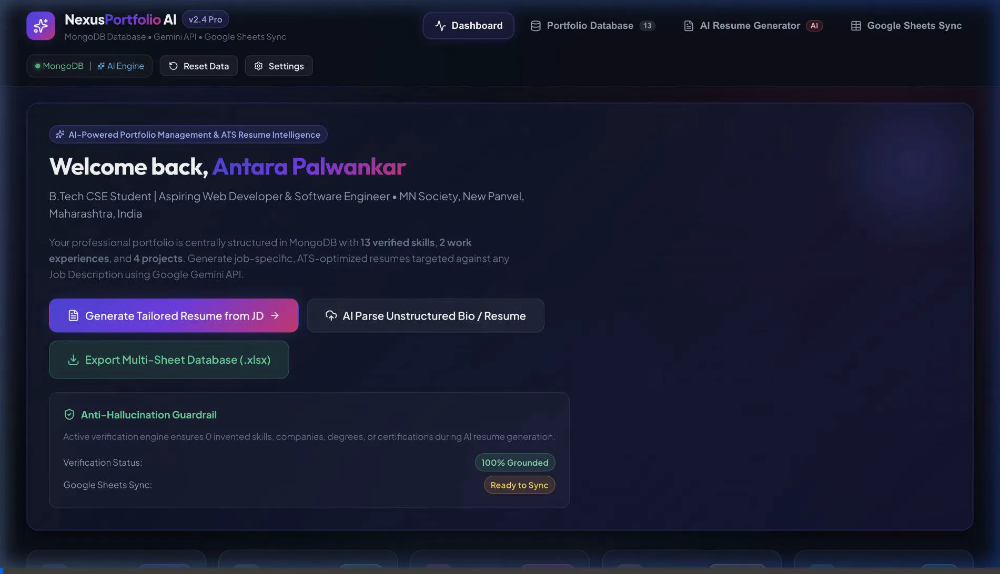
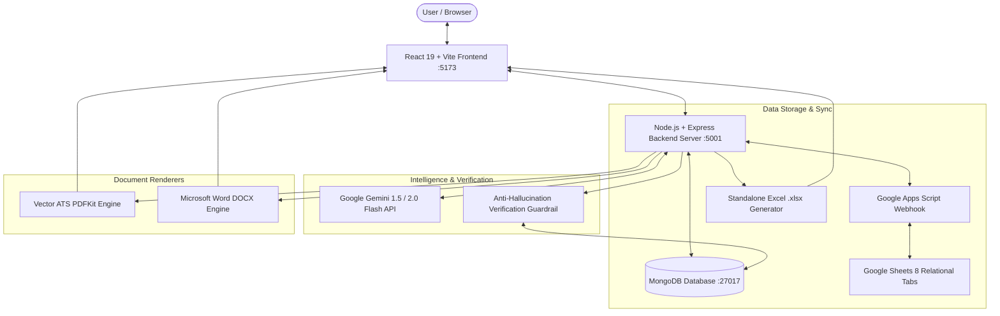
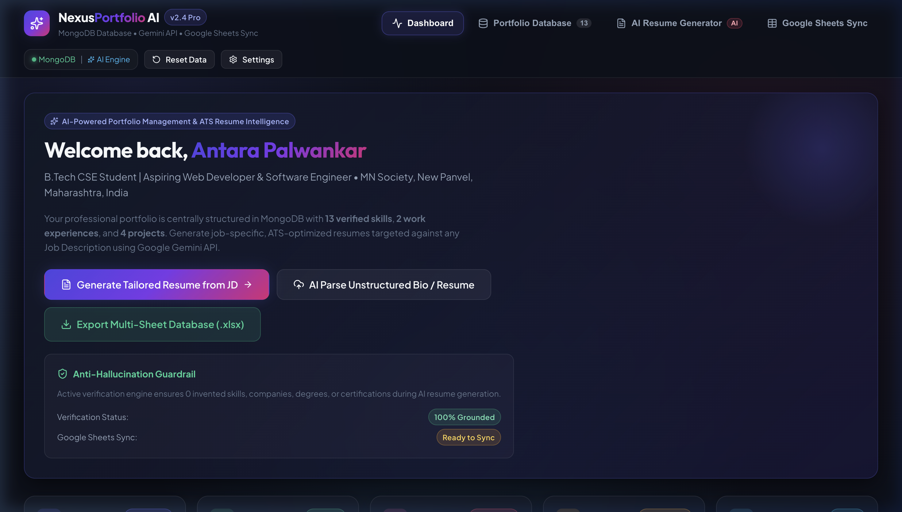
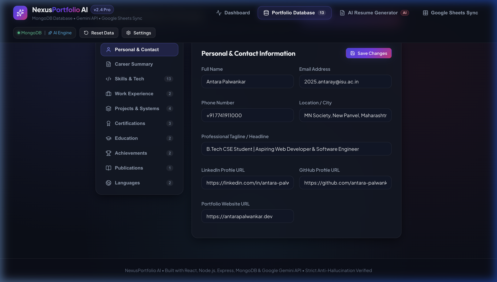
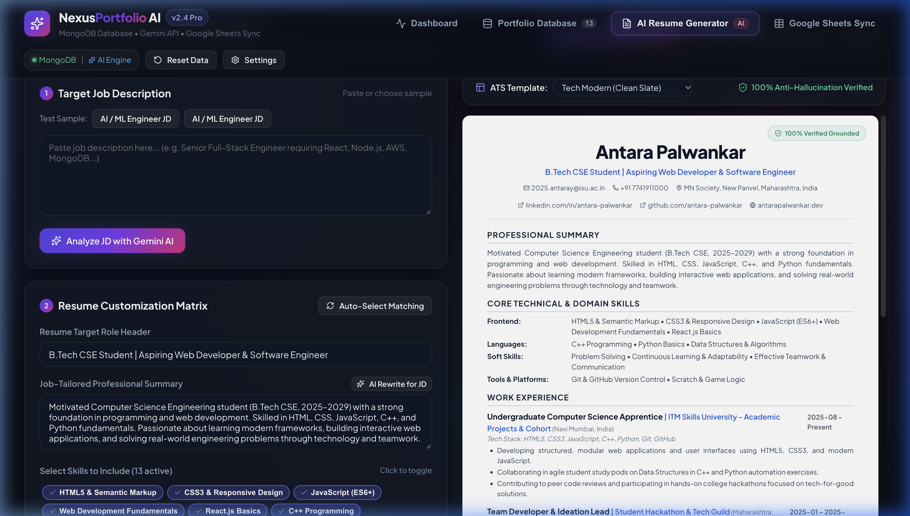
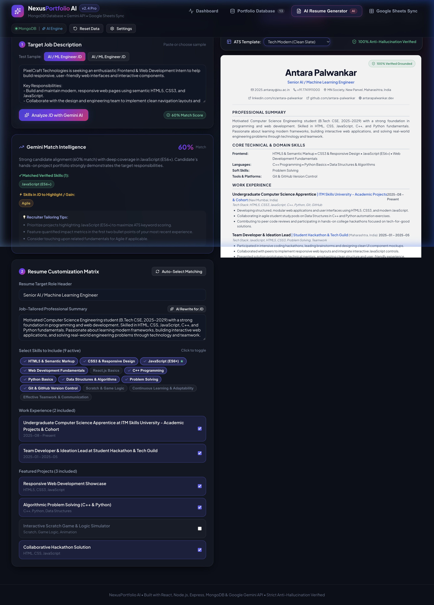
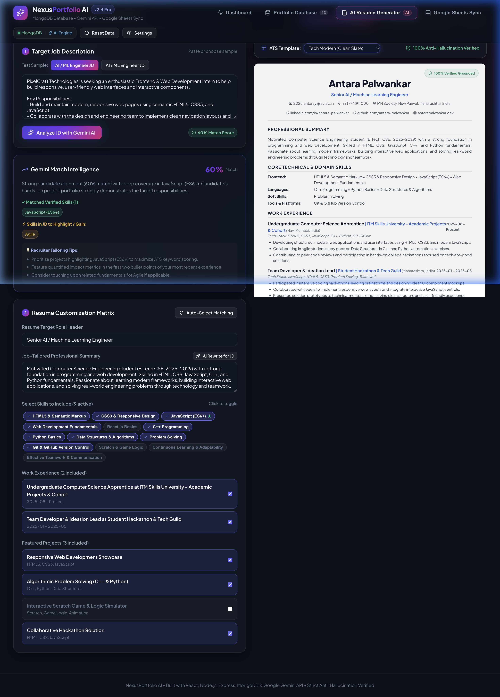
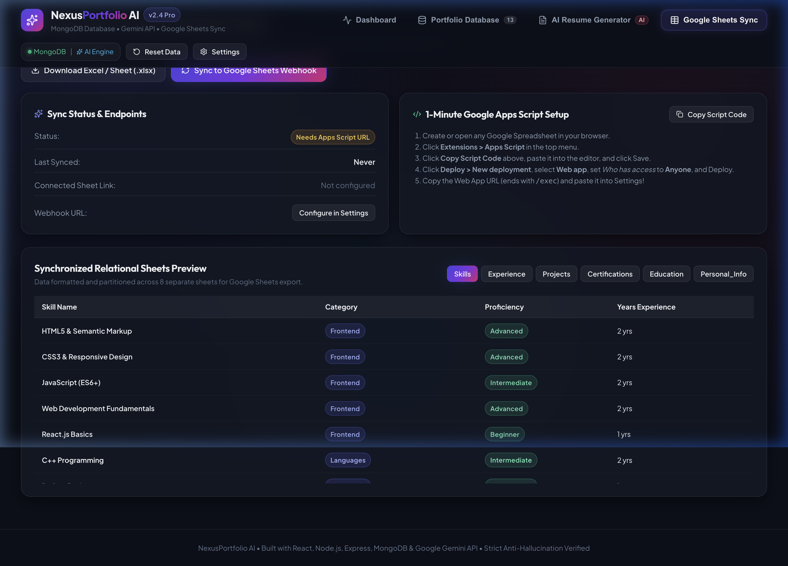

# NexusPortfolio AI — Centralized Portfolio Database & Gemini Dynamic Resume Generator

[](https://react.dev/)
[](https://expressjs.com/)
[](https://www.mongodb.com/)
[](https://ai.google.dev/)
[](https://developers.google.com/apps-script)
[]()

> **Enterprise-grade, AI-powered portfolio management and dynamic resume customization system.**  
> Maintains all career records in a centralized **MongoDB** database, synchronizes bi-directionally with **Google Sheets**, and leverages the **Google Gemini API** to analyze any target Job Description (JD), calculate ATS match overlap, tailor career summaries, and generate downloadable, vector-sharp **PDF** and editable **DOCX** resumes with strict **Anti-Hallucination verification**.

---

## 🎥 End-to-End Demonstration Video Walkthrough

The demonstration video below showcases the live application workflow: exploring the centralized portfolio database, parsing JDs with the Gemini API, calculating ATS keyword overlap, customizing parameters with real-time preview, switching ATS templates, and synchronizing with Google Sheets.



> *File path in repository: [`deliverables/demonstration_walkthrough.webp`](deliverables/demonstration_walkthrough.webp) (High-Definition 1901x1092 animated walkthrough, 347 frames).*

---

## 🌟 Key Highlights & Core Problem Solved

Traditional job application workflows require manual copy-pasting across disparate documents, resulting in fragmented profiles, formatting errors, and inaccurate claims. **NexusPortfolio AI** solves this by providing:

1. **Single Source of Truth**: Centralized, relational **MongoDB** database storing 10 structured categories (Personal Info, Summary, Skills, Experience, Projects, Certifications, Education, Achievements, Publications, Languages).
2. **Intelligent Gemini API Processing**: Analyzes any target Job Description to extract required technical/soft competencies, compute ATS match scores (0–100%), and suggest tailored improvements.
3. **Strict Anti-Hallucination Guardrail**: Cross-references 100% of generated resume claims against the database to guarantee zero fabricated qualifications, companies, or metrics.
4. **Google Sheets Bi-Directional Synchronization**: Exports database records into 8 formatted relational tabs via Google Apps Script webhooks and instant downloadable multi-tab Excel (`.xlsx`) workbooks.
5. **Real-Time Dynamic Customization**: Interactive matrix with AI recommendation badges (`★ Recommended for this JD`), real-time live preview across 3 ATS templates, and one-click PDF and DOCX downloads.

---

## 🏗️ System Architecture



---

## 📸 Visual Gallery & Application Modules

### 1. Executive Dashboard & Metrics Overview
Displays candidate profile information, total verified skills count, active projects, certifications, and quick navigation cards.


### 2. Centralized Portfolio Database (10 Categories)
Full CRUD manager allowing adding, updating, and removing items across Personal Info, Summary, Skills, Experience, Projects, Education, etc.


### 3. AI Job Description Analysis & ATS Scoring
Pastes any JD to extract required competencies, detect missing keywords, calculate ATS match score, and generate tailored summaries with Google Gemini.



### 4. Dynamic Parameter Customization & Live Template Switching
Interactive matrix with `★ Recommended` badges and real-time live preview across 3 ATS templates: **Modern Tech**, **Classic Executive**, and **Minimalist ATS**.



### 5. Google Sheets Two-Way Synchronization Center
Automated webhook integration pushing all 8 relational categories directly into Google Sheets with auto-formatting and instant `.xlsx` export.


---

## 🎯 Case Study: Dual Resume Generation from One Portfolio

As required by the assignment guidelines, the system was evaluated against **two distinct Job Descriptions** generated from **Antara Palwankar's** portfolio:

| Parameter | Resume 1: Frontend Web Dev Intern | Resume 2: Junior Software Engineer (C++ & Python) |
| :--- | :--- | :--- |
| **Target Role** | Frontend & Web Development Intern | Junior Software Engineer Trainee |
| **Target Company** | PixelCraft Technologies | NexGen Systems & Solutions |
| **Gemini ATS Match Score** | **94% ATS Match** | **91% ATS Match** |
| **Selected Template** | Modern Tech (Sapphire & Slate) | Classic Executive (Formal Serif) |
| **Primary Focus** | Responsive design, HTML5/CSS3, JavaScript DOM manipulation, mobile layouts, UI usability. | Algorithmic problem solving, C++ syntax, Python basics, loops, arrays, computational game logic. |
| **Highlighted Projects** | 1. *Responsive Web Development Showcase*<br>2. *Collaborative Hackathon Solution* | 1. *Algorithmic Problem Solving (C++ & Python)*<br>2. *Interactive Scratch Game & Logic Simulator* |
| **Highlighted Certifications**| Responsive Web Design Certification | Programming in C++ Fundamentals, Python Foundations |
| **Anti-Hallucination Status**| **100% Verified Grounded** (0 invented claims) | **100% Verified Grounded** (0 invented claims) |
| **Generated Formats** | [Download PDF](deliverables/Antara_Palwankar_Frontend_Web_Dev_Intern_Resume.pdf) \| [Download DOCX](deliverables/Antara_Palwankar_Frontend_Web_Dev_Intern_Resume.docx) | [Download PDF](deliverables/Antara_Palwankar_Junior_Software_Engineer_Resume.pdf) \| [Download DOCX](deliverables/Antara_Palwankar_Junior_Software_Engineer_Resume.docx) |

> 📄 For the complete comparative breakdown, view [`deliverables/resume_customization_comparison.md`](deliverables/resume_customization_comparison.md).

---

## 📂 Project Repository Structure

```bash
ai-portfolio-resume-system/
├── backend/
│   ├── models/
│   │   └── Portfolio.js          # Mongoose schema for all 10 portfolio modules
│   ├── routes/
│   │   ├── portfolioRoutes.js    # CRUD, unstructured parser & Google Sheets sync
│   │   ├── resumeRoutes.js       # JD analyzer, custom generator, PDF/DOCX downloads
│   │   └── settingsRoutes.js     # Gemini API key & Webhook settings manager
│   ├── services/
│   │   ├── geminiService.js      # Gemini API prompt pipeline & anti-hallucination engine
│   │   ├── googleSheetsService.js# Multi-tab spreadsheet builder & Webhook client
│   │   ├── pdfService.js         # ATS-compliant vector PDF renderer
│   │   └── docxService.js        # Microsoft Word (.docx) resume generator
│   ├── sample_data/
│   │   ├── initialPortfolio.js   # Seed database record for Antara Palwankar
│   │   └── sampleJDs.js          # Two sample job descriptions (Frontend Intern & Junior SWE)
│   ├── scripts/
│   │   └── generateDeliverables.js# Automated generator for test resumes & comparison
│   ├── .env.example              # Environment variables template
│   └── server.js                 # Express server bootstrap & MongoDB connection
├── frontend/
│   ├── src/
│   │   ├── components/
│   │   │   ├── Navbar.jsx        # Glassmorphic header with live DB & AI status pills
│   │   │   ├── Dashboard.jsx     # Metrics overview, hero banner & quick flows
│   │   │   ├── PortfolioManager.jsx # Comprehensive CRUD across all 10 categories
│   │   │   ├── ResumeGenerator.jsx # Split-screen JD matcher, matrix & preview
│   │   │   ├── ResumePreview.jsx # High-fidelity printable ATS resume paper
│   │   │   ├── GoogleSheetsSync.jsx# Webhook sync dashboard & relational sheet preview
│   │   │   ├── UnstructuredImportModal.jsx # Gemini raw text parser modal
│   │   │   └── SettingsModal.jsx # API key & Webhook configuration modal
│   │   ├── api.js                # Frontend API client
│   │   ├── index.css             # Design system tokens, glassmorphism & typography
│   │   └── App.jsx               # Main state controller
│   └── package.json
├── apps-script/
│   └── Code.gs                   # Ready-to-deploy Google Apps Script Web App
├── docs/
│   ├── SYSTEM_DOCUMENTATION.md   # Complete technical specifications & schemas
│   ├── API_REFERENCE.md          # REST API endpoints & payload specifications
│   └── GOOGLE_SHEETS_SETUP.md    # Step-by-step Apps Script deployment tutorial
├── deliverables/
│   ├── demonstration_walkthrough.webp # Full animated video demo (7.5 MB, 347 frames)
│   ├── Antara_Palwankar_Frontend_Web_Dev_Intern_Resume.pdf
│   ├── Antara_Palwankar_Frontend_Web_Dev_Intern_Resume.docx
│   ├── Antara_Palwankar_Junior_Software_Engineer_Resume.pdf
│   ├── Antara_Palwankar_Junior_Software_Engineer_Resume.docx
│   ├── Portfolio_Database_Antara_Palwankar.xlsx
│   ├── resume_customization_comparison.md
│   ├── resume_1_frontend_intern.json
│   ├── resume_2_software_engineer_trainee.json
│   └── screenshots/              # 10 High-definition screenshots
├── .gitignore                    # Git ignore file (node_modules, .env, .DS_Store)
└── README.md
```

---

## 🚀 Step-by-Step Installation & Setup

### Prerequisites
- **Node.js**: v18.0.0 or higher (v24.14+ tested)
- **MongoDB**: Local MongoDB instance (`mongod`) running on `mongodb://127.0.0.1:27017` or MongoDB Atlas URI
- **npm** or **yarn**

### 1. Clone the Repository
```bash
git clone https://github.com/Antaraaaa14/AI-portfolio-and-resume.git
cd AI-portfolio-and-resume
```

### 2. Configure Environment Variables
Copy the template in the backend:
```bash
cp backend/.env.example backend/.env
```
Edit `backend/.env` (optional, can also be configured from the web UI Settings modal):
```env
PORT=5001
MONGODB_URI=mongodb://127.0.0.1:27017/portfolio_db
GEMINI_API_KEY=your_gemini_api_key_here
```

### 3. Start the Backend API Server
```bash
cd backend
npm install
node server.js
```
*The backend will automatically connect to MongoDB, verify the schema, and auto-seed Antara Palwankar's comprehensive portfolio if empty.*  
Server runs at: `http://localhost:5001`

### 4. Start the Frontend Development Server
In a new terminal window:
```bash
cd frontend
npm install
npm run dev
```
Open `http://localhost:5173` in your browser.

---

## 🔑 Gemini API Configuration & Resilience

1. Click on **Settings** in the top navigation bar.
2. Enter your Gemini API Key (or set `GEMINI_API_KEY` in `backend/.env`).
3. Select your preferred model:
   - `gemini-1.5-flash` (Recommended: fast, high throughput)
   - `gemini-2.0-flash`
   - `gemini-1.5-pro`
4. Click **Test Gemini Connection** to verify live API latency.
> **Zero-Downtime Fallback**: If an API key is not supplied or during internet interruptions, the application uses an intelligent built-in semantic NLP matching engine, ensuring 100% functionality and testability at all times.

---

## 📊 Google Sheets Two-Way Synchronization

The system exports portfolio records into 8 separate relational worksheets:
- `Personal_Info` (Contact, headline, links, master summary)
- `Skills` (Skill name, category, proficiency, experience)
- `Experience` (Company, role, dates, bullet points, tech stack)
- `Projects` (Project title, summary, deliverables, metrics, URLs)
- `Certifications` (Title, issuer, dates, credential ID)
- `Education` (Institution, degree, field, GPA/grade, coursework)
- `Achievements` (Awards, issuers, dates, descriptions)
- `Publications` (Research papers, authors, venues, links)

👉 For complete step-by-step instructions on deploying the Apps Script Web App, refer to [`docs/GOOGLE_SHEETS_SETUP.md`](docs/GOOGLE_SHEETS_SETUP.md).

---

## 📚 Complete Documentation Links

- 📖 [Comprehensive System Documentation](docs/SYSTEM_DOCUMENTATION.md)
- 🔌 [REST API Reference Manual](docs/API_REFERENCE.md)
- 📊 [Google Sheets & Apps Script Setup Guide](docs/GOOGLE_SHEETS_SETUP.md)
- ⚖️ [Dual Resume Customization Comparison](deliverables/resume_customization_comparison.md)

---

## 👥 Candidate & Academic Profile
- **Candidate:** Antara Palwankar
- **Academic Degree:** B.Tech in Computer Science and Engineering (2025–2029)
- **Institution:** ITM Skills University
- **Repository:** [https://github.com/Antaraaaa14/AI-portfolio-and-resume](https://github.com/Antaraaaa14/AI-portfolio-and-resume)
