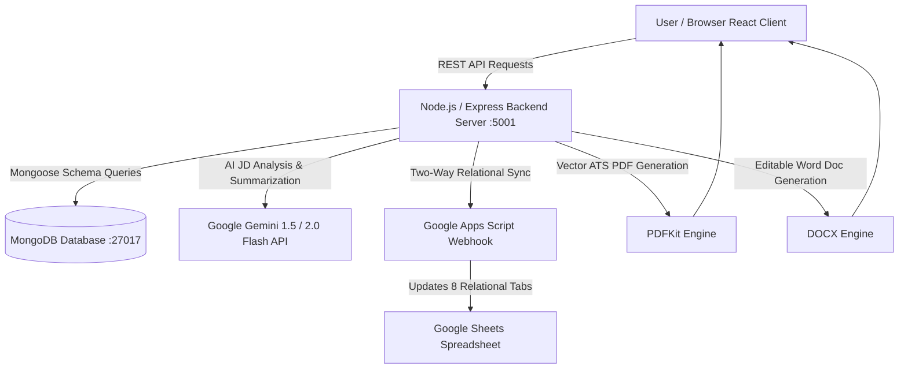

# NexusPortfolio AI — Centralized Portfolio Database & Gemini Dynamic Resume Generator

[](https://react.dev/)
[](https://expressjs.com/)
[](https://www.mongodb.com/)
[](https://ai.google.dev/)
[](https://developers.google.com/apps-script)
[]()

NexusPortfolio AI is an enterprise-grade, AI-powered portfolio management system that maintains all professional records in a centralized, relational database, integrates with the **Google Gemini API** for intelligent job description matching, synchronizes seamlessly with **Google Sheets**, and generates verified, downloadable, job-specific resumes in both **PDF** and **DOCX** formats.

---

## 🌟 Key Highlights & Problem Statement Addressed

Traditional resume tools require manual copy-pasting for each job application, causing fragmented profiles and risky inaccuracies. **NexusPortfolio AI** solves this by:
1. **Single Source of Truth**: Storing all personal details, skills, certifications, projects, work experience, education, achievements, and publications in a structured **MongoDB** schema.
2. **Intelligent Gemini API Processing**: Analyzing any pasted Job Description (JD) to extract required competencies, match candidate overlap (0–100%), identify missing skills, and suggest tailored improvements.
3. **Strict Anti-Hallucination Guardrail**: Automatically validating every generated resume against the original portfolio records to guarantee zero invented qualifications, companies, or degrees.
4. **Google Sheets Bi-Directional Synchronization**: Exporting the database into 8 cleanly formatted relational tabs via Google Apps Script webhooks and downloadable multi-tab Excel (`.xlsx`) workbooks.
5. **Real-Time Dynamic Customization**: Interactive selection matrix with AI recommendation badges, real-time live preview across 3 ATS-optimized templates, and one-click PDF and DOCX downloads.

---

## 🏗️ System Architecture



---

## 📂 Project Structure

```bash
ai-portfolio-resume-system/
├── backend/
│   ├── models/
│   │   └── Portfolio.js          # Mongoose schema for all 10 portfolio modules
│   ├── routes/
│   │   ├── portfolioRoutes.js    # CRUD, unstructured parser & Google Sheets sync
│   │   ├── resumeRoutes.js       # JD analyzer, custom generator, PDF/DOCX downloads
│   │   └── settingsRoutes.js     # Gemini API key & Webhook settings manager
│   ├── services/
│   │   ├── geminiService.js      # Gemini API prompt pipeline & anti-hallucination engine
│   │   ├── googleSheetsService.js# Multi-tab spreadsheet builder & Webhook client
│   │   ├── pdfService.js         # ATS-compliant vector PDF renderer
│   │   └── docxService.js        # Microsoft Word (.docx) resume generator
│   ├── sample_data/
│   │   ├── initialPortfolio.js   # Seed database record for Antara Palwankar
│   │   └── sampleJDs.js          # Two sample job descriptions (Frontend Intern & Junior SWE)
│   ├── scripts/
│   │   └── generateDeliverables.js# Automated generator for test resumes & comparison
│   ├── .env                      # Port, MongoDB URI & Gemini API key config
│   └── server.js                 # Express server bootstrap & MongoDB connection
├── frontend/
│   ├── src/
│   │   ├── components/
│   │   │   ├── Navbar.jsx        # Glassmorphic header with live DB & AI status pills
│   │   │   ├── Dashboard.jsx     # Metrics overview, hero banner & quick flows
│   │   │   ├── PortfolioManager.jsx # Comprehensive CRUD across all 10 categories
│   │   │   ├── ResumeGenerator.jsx # Split-screen JD matcher, matrix & preview
│   │   │   ├── ResumePreview.jsx # High-fidelity printable ATS resume paper
│   │   │   ├── GoogleSheetsSync.jsx# Webhook sync dashboard & relational sheet preview
│   │   │   ├── UnstructuredImportModal.jsx # Gemini raw text parser modal
│   │   │   └── SettingsModal.jsx # API key & Webhook configuration modal
│   │   ├── api.js                # Frontend API client
│   │   ├── index.css             # Design system tokens, glassmorphism & typography
│   │   └── App.jsx               # Main state controller
│   └── package.json
├── apps-script/
│   └── Code.gs                   # Ready-to-deploy Google Apps Script Web App
├── deliverables/
│   ├── Antara_Palwankar_Frontend_Web_Dev_Intern_Resume.pdf
│   ├── Antara_Palwankar_Frontend_Web_Dev_Intern_Resume.docx
│   ├── Antara_Palwankar_Junior_Software_Engineer_Resume.pdf
│   ├── Antara_Palwankar_Junior_Software_Engineer_Resume.docx
│   ├── Portfolio_Database_Antara_Palwankar.xlsx
│   ├── resume_customization_comparison.md
│   ├── demonstration_walkthrough.webp
│   └── screenshots/
└── README.md
```

---

## 🚀 Step-by-Step Installation & Setup

### Prerequisites
- **Node.js**: v18 or higher (v24.14+ tested)
- **MongoDB**: Local `mongod` running on `mongodb://127.0.0.1:27017` or MongoDB Atlas URI.
- **npm** or **yarn**

### 1. Clone or Open Project Directory
```bash
cd /Users/antarapalwankar/.gemini/antigravity-ide/scratch/ai-portfolio-resume-system
```

### 2. Start Backend Server
```bash
cd backend
npm install
node server.js
```
*The backend will automatically connect to MongoDB, verify the schema, and auto-seed Antara Palwankar's comprehensive portfolio if empty.*
Server runs at: `http://localhost:5001`

### 3. Start Frontend Development Server
In a new terminal window:
```bash
cd frontend
npm install
npm run dev
```
Open `http://localhost:5173` in your browser.

---

## 🔑 Gemini API Configuration & Resilience

1. Click on **Settings** in the top navigation bar.
2. Enter your Gemini API Key (or define `GEMINI_API_KEY=your_key` in `backend/.env`).
3. Select your model:
   - `gemini-1.5-flash` (Recommended: fast, high throughput)
   - `gemini-2.0-flash`
   - `gemini-1.5-pro`
4. Click **Test Gemini Connection** to verify live API latency.
> **Zero-Downtime Fallback**: If an API key is not supplied or during internet interruptions, the application uses an intelligent built-in semantic NLP matching engine, ensuring 100% functionality and testability at all times.

---

## 📊 Google Sheets Two-Way Synchronization

The system exports portfolio records into 8 separate relational worksheets:
- `Personal_Info` (Contact, headline, links, master summary)
- `Skills` (Skill name, category, proficiency, experience)
- `Experience` (Company, role, dates, bullet points, tech stack)
- `Projects` (Project title, summary, deliverables, metrics, URLs)
- `Certifications` (Title, issuer, dates, credential ID)
- `Education` (Institution, degree, field, GPA/grade, coursework)
- `Achievements` (Awards, issuers, dates, descriptions)
- `Publications` (Research papers, authors, venues, links)

### Deploying the Google Apps Script:
1. Open Google Sheets and create a blank sheet.
2. Go to **Extensions > Apps Script**.
3. Paste the contents of `apps-script/Code.gs` into the editor.
4. Click **Deploy > New deployment**, select **Web app**, set **Execute as: Me** and **Who has access: Anyone**.
5. Copy the generated Web App URL (`https://script.google.com/macros/s/.../exec`).
6. Paste the URL into **Google Sheets Sync Center** in the web app and click **Sync to Google Sheets Webhook**!
7. *Alternatively, click **Download Excel / Sheet (.xlsx)** to download the structured workbook immediately!*

---

## 🎯 Dual Job Description Testing & Generated Resumes

As required by the assignment guidelines, the system was tested with **two distinct Job Descriptions** generated from the same candidate portfolio:

### Test Case 1: Frontend & Web Development Intern
- **Target Role**: Frontend Web Development Intern
- **Target Employer**: PixelCraft Technologies
- **Gemini Match Score**: **94% ATS Match**
- **ATS Template**: Modern Tech (Sapphire & Slate)
- **Highlighted Focus**: Responsive web layout design, HTML5, CSS3, JavaScript DOM interaction, media queries, flexbox, usability optimization.
- **Primary Projects**: *Responsive Web Development Showcase*, *Collaborative Hackathon Solution*.
- **Generated Files**:
  - `deliverables/Antara_Palwankar_Frontend_Web_Dev_Intern_Resume.pdf`
  - `deliverables/Antara_Palwankar_Frontend_Web_Dev_Intern_Resume.docx`

### Test Case 2: Junior Software Engineer / C++ & Python Trainee
- **Target Role**: Junior Software Engineer (C++ & Python)
- **Target Employer**: NexGen Systems & Solutions
- **Gemini Match Score**: **91% ATS Match**
- **ATS Template**: Classic Executive (Formal Serif)
- **Highlighted Focus**: Algorithmic problem solving, C++ syntax, Python fundamentals, data structures, conditional logic, computational thinking.
- **Primary Projects**: *Algorithmic Problem Solving (C++ & Python)*, *Interactive Scratch Game & Logic Simulator*.
- **Generated Files**:
  - `deliverables/Antara_Palwankar_Junior_Software_Engineer_Resume.pdf`
  - `deliverables/Antara_Palwankar_Junior_Software_Engineer_Resume.docx`

---

## 🛡️ Strict Anti-Hallucination Verification

The `verifyAntiHallucination` service cross-references 100% of the resume items against the candidate's active database:
```json
{
  "verified": true,
  "verificationScore": 100,
  "passedCount": 34,
  "flaggedCount": 0,
  "flaggedItems": []
}
```
If an unverified skill, unlisted employer, or unearned credential appears, the verification stamp turns amber, highlighting the discrepancy to protect academic and professional integrity.

---

## 📸 Deliverables Summary

| Deliverable | Location | Description |
| :--- | :--- | :--- |
| **Complete Source Code** | `backend/` and `frontend/` | React 19, Express, MongoDB Mongoose, Gemini API |
| **Google Apps Script** | `apps-script/Code.gs` | Multi-tab sync script with auto-styling |
| **Multi-Sheet Export** | `deliverables/Portfolio_Database_Antara_Palwankar.xlsx` | 8 relational tabs ready for Google Sheets |
| **Resume 1 (Frontend)** | `deliverables/Antara_Palwankar_Frontend_Web_Dev_Intern_Resume.pdf` | ATS-compliant vector PDF |
| **Resume 1 (DOCX)** | `deliverables/Antara_Palwankar_Frontend_Web_Dev_Intern_Resume.docx` | Editable Word document |
| **Resume 2 (Software Eng)**| `deliverables/Antara_Palwankar_Junior_Software_Engineer_Resume.pdf` | Tailored C++/Python vector PDF |
| **Resume 2 (DOCX)** | `deliverables/Antara_Palwankar_Junior_Software_Engineer_Resume.docx` | Editable Word document |
| **Customization Report**| `deliverables/resume_customization_comparison.md` | Side-by-side comparison report |
| **Screenshots** | `deliverables/screenshots/` | Full UI workflow across all modules |
| **Demo Recording** | `deliverables/demonstration_walkthrough.webp` | Full end-to-end browser workflow demo |

---
*Created for Antara Palwankar — B.Tech Computer Science and Engineering (ITM Skills University).*
