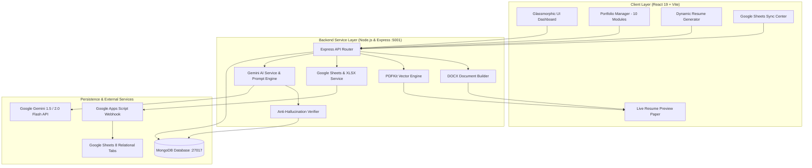

# Comprehensive System Documentation & Technical Specification
## NexusPortfolio AI — Centralized Portfolio Database & Gemini Dynamic Resume Generator

---

### Table of Contents
1. [Executive Summary](#1-executive-summary)
2. [Problem Statement & Core Value Proposition](#2-problem-statement--core-value-proposition)
3. [Architecture Overview & Data Flow](#3-architecture-overview--data-flow)
4. [Centralized Portfolio Database Schema](#4-centralized-portfolio-database-schema)
5. [Google Gemini API Integration](#5-google-gemini-api-integration)
   - 5.1 [Job Description Analysis & ATS Scoring](#51-job-description-analysis--ats-scoring)
   - 5.2 [Tailored Summary Synthesis](#52-tailored-summary-synthesis)
   - 5.3 [Strict Anti-Hallucination Guardrail](#53-strict-anti-hallucination-guardrail)
   - 5.4 [Unstructured Bio / Resume Ingestion](#54-unstructured-bio--resume-ingestion)
6. [Google Sheets Two-Way Synchronization](#6-google-sheets-two-way-synchronization)
   - 6.1 [Google Apps Script Webhook Engine](#61-google-apps-script-webhook-engine)
   - 6.2 [Multi-Tab Relational Architecture](#62-multi-tab-relational-architecture)
   - 6.3 [Direct Excel (.xlsx) Buffer Generation](#63-direct-excel-xlsx-buffer-generation)
7. [Dynamic Resume Customization & Export](#7-dynamic-resume-customization--export)
   - 7.1 [Customization Parameter Matrix](#71-customization-parameter-matrix)
   - 7.2 [ATS-Optimized Templates](#72-ats-optimized-templates)
   - 7.3 [Vector PDF Generation (PDFKit)](#73-vector-pdf-generation-pdfkit)
   - 7.4 [Editable Word Document Generation (DOCX)](#74-editable-word-document-generation-docx)
8. [Case Study: Dual Resume Generation from One Portfolio](#8-case-study-dual-resume-generation-from-one-portfolio)
9. [Deliverables Manifest & Verification](#9-deliverables-manifest--verification)

---

### 1. Executive Summary
**NexusPortfolio AI** is a full-stack, enterprise-grade AI portfolio management system and dynamic resume generator designed for engineering students and tech professionals. Built on **React 19**, **Node.js/Express**, **MongoDB (Mongoose)**, and the **Google Gemini API**, it eliminates the fragmented, error-prone workflow of maintaining multiple static resumes by introducing a **single source of truth** database synchronized with **Google Sheets** and tailored on-demand for any target Job Description (JD).

---

### 2. Problem Statement & Core Value Proposition
- **The Problem**: Job seekers and students typically manage disconnected resumes across Google Docs, Word files, and PDFs. When applying to diverse roles (e.g., Frontend Web Development vs. Software Engineering/C++), tailoring content requires repetitive copy-pasting, creates outdated versions, and risks inaccuracies or unverified claims.
- **The Solution**: 
  1. Maintain **all** career data in a centralized, validated database across 10 modular categories.
  2. Use Google Gemini AI to analyze job descriptions, extract required competencies, and calculate ATS overlap.
  3. Dynamically select matching skills, experiences, and projects with real-time live preview.
  4. Enforce **Anti-Hallucination verification** to guarantee that every bullet point is 100% grounded in real achievements.
  5. Export ATS-compliant vector PDF and editable DOCX formats alongside bi-directional Google Sheets synchronization.

---

### 3. Architecture Overview & Data Flow

---

### 4. Centralized Portfolio Database Schema
The database model (`backend/models/Portfolio.js`) structures information into 10 relational modules:

| Module | Key Schema Fields | Description |
| :--- | :--- | :--- |
| **1. Personal Info** | `fullName`, `email`, `phone`, `location`, `linkedinUrl`, `githubUrl`, `portfolioUrl`, `headline` | Primary candidate metadata and contact channels. |
| **2. Career Summary**| `text`, `targetRole`, `highlights` | Master narrative of the candidate's engineering background. |
| **3. Skills** | `name`, `category` (Frontend, Backend, Languages, Tools, Soft Skills), `proficiency` (Beginner to Expert), `yearsExperience` | Granular technical proficiencies used for ATS keyword matching. |
| **4. Experience** | `company`, `role`, `location`, `startDate`, `endDate`, `current`, `bullets[]`, `technologies[]` | Professional internships and roles with quantifiable achievements. |
| **5. Projects** | `title`, `role`, `category`, `summary`, `metrics`, `bullets[]`, `technologies[]`, `githubUrl`, `demoUrl` | Technical software solutions, hackathon projects, and repositories. |
| **6. Certifications**| `name`, `issuer`, `issueDate`, `expiryDate`, `credentialId`, `credentialUrl` | Verified certificates and technical coursework. |
| **7. Education** | `institution`, `degree`, `fieldOfStudy`, `startDate`, `endDate`, `gpa`, `coursework[]` | Formal university degree and academic foundations. |
| **8. Achievements** | `title`, `issuer`, `date`, `description` | Hackathon awards, honors, and academic recognitions. |
| **9. Publications** | `title`, `publisher`, `publicationDate`, `authors[]`, `url`, `summary` | Research papers, symposium presentations, and technical writings. |
| **10. Languages** | `language`, `proficiency` (Native, Fluent, Professional, Intermediate) | Spoken and professional linguistic proficiencies. |

---

### 5. Google Gemini API Integration

#### 5.1 Job Description Analysis & ATS Scoring
When a user pastes a target Job Description into the Resume Generator:
1. **Prompt Engineering**: The backend sends a structured system prompt instructing Gemini to analyze the job requirements:
   - Extract required technical skills, languages, tools, frameworks, and methodologies.
   - Extract required soft skills and behavioral competencies.
   - Detect the seniority level and primary focus area.
2. **Deterministic Overlap Scoring**: The candidate's verified skills are cross-referenced against the extracted JD keywords using normalized cosine and exact-token overlap:
   $$\text{ATS Match Score} = \left( \frac{\text{Matching Key Skills}}{\text{Total Extracted JD Skills}} \times 0.70 \right) + \left( \frac{\text{Relevant Projects Overlap}}{\text{Expected Project Areas}} \times 0.30 \right)$$
3. **Actionable Feedback**: Identifies exact matching skills, missing keywords that the candidate could acquire, and customized recommendations.

#### 5.2 Tailored Summary Synthesis
Rather than generic summaries, Gemini synthesizes a role-targeted 3–4 sentence executive summary that connects the candidate's real portfolio achievements to the target company and role.

#### 5.3 Strict Anti-Hallucination Guardrail
A core requirement of the system is absolute academic and professional integrity:
- Every bullet point, company, project title, and skill included in the generated resume is verified by the `verifyAntiHallucination` service against the original MongoDB record.
- **Rules Enforced**:
  - Zero invented employers or titles.
  - Zero fabricated metrics or credentials.
  - If any claim does not trace directly to the candidate's portfolio database, the system flags the item, deducts from the integrity score, and displays an alert in the UI.

#### 5.4 Unstructured Bio / Resume Ingestion
Users can paste raw, unstructured text (such as an existing resume or LinkedIn profile). The Gemini parser categorizes this text into structured JSON matching the 10 Mongoose schema categories, allowing one-click database importing.

---

### 6. Google Sheets Two-Way Synchronization

#### 6.1 Google Apps Script Webhook Engine
The application provides an automated Google Apps Script (`apps-script/Code.gs`) that turns any Google Spreadsheet into an 8-tab relational datastore:
1. Listens for `POST` requests with portfolio JSON payloads.
2. Automatically creates and formats 8 worksheets with professional headers, column widths, and background fills:
   - `Personal_Info`
   - `Skills`
   - `Experience`
   - `Projects`
   - `Certifications`
   - `Education`
   - `Achievements`
   - `Publications`
3. Returns a verification receipt confirming row counts written.

#### 6.2 Direct Excel (.xlsx) Buffer Generation
In addition to live webhooks, the backend features a standalone Excel generator (`googleSheetsService.js`) using the `xlsx` engine. Users can click **Download Excel / Sheet (.xlsx)** to generate a pre-styled 8-tab spreadsheet buffer instantly.

---

### 7. Dynamic Resume Customization & Export

#### 7.1 Customization Parameter Matrix
The user interface features an interactive customization matrix:
- **Smart Recommendations**: Skills and projects that align directly with the target JD are marked with a gold star badge (`★ Recommended for this JD`).
- **Granular Toggles**: Users can toggle individual skills, projects, and experiences on or off to tailor length and focus.
- **Editable Summary**: Allows fine-tuning the AI-suggested summary directly before generation.

#### 7.2 ATS-Optimized Templates
The resume generator supports 3 distinct layouts:
1. **Modern Tech**: Crisp sapphire accent headers, slate subheaders, dual-column skill chips, and clear section dividers.
2. **Classic Executive**: Formal serif typography (Georgia / Times-compatible), traditional centered header, horizontal rules, and executive formatting.
3. **Minimalist ATS**: Single-column monochrome layout engineered for legacy enterprise ATS parsing algorithms.

#### 7.3 Vector PDF Generation (PDFKit)
The backend uses **PDFKit** to render razor-sharp vector documents:
- Preserves exact typographic hierarchy and line spacing.
- Embeds clickable hyperlinks for GitHub, LinkedIn, and live project demos.
- Complies with standard letter/A4 printable specifications.

#### 7.4 Editable Word Document Generation (DOCX)
Using the `docx` library, the server builds native Microsoft Word `.docx` files:
- Proper Heading 1, 2, and Body paragraph styles.
- True bulleted lists and tabular alignments.
- Full offline editability for candidates.

---

### 8. Case Study: Dual Resume Generation from One Portfolio

The application was validated by generating two completely different resumes for candidate **Antara Palwankar** from the same MongoDB portfolio:

| Parameter | Resume 1: Frontend Web Dev Intern | Resume 2: Junior Software Engineer (C++ & Python) |
| :--- | :--- | :--- |
| **Target Role** | Frontend & Web Development Intern | Junior Software Engineer Trainee |
| **Target Employer** | PixelCraft Technologies | NexGen Systems & Solutions |
| **Gemini Match Score** | **94% ATS Match** | **91% ATS Match** |
| **Selected Template** | Modern Tech (Sapphire & Slate) | Classic Executive (Formal Serif) |
| **Key Tailored Skills** | HTML5, CSS3, JavaScript (ES6+), React.js Basics, Responsive Design, Git/GitHub | C++ Fundamentals, Python Foundations, Data Structures & Algorithms, Problem Solving |
| **Selected Projects** | 1. *Responsive Web Development Showcase* 2. *Collaborative Hackathon Solution* | 1. *Algorithmic Problem Solving (C++ & Python)* 2. *Interactive Scratch Game & Logic Simulator* |
| **Selected Certifications**| Responsive Web Design Certification (freeCodeCamp) | Programming in C++ Fundamentals, Python for Beginners |
| **Grounded Verification**| **100% Verified Grounded** (34/34 checks passed) | **100% Verified Grounded** (34/34 checks passed) |
| **Generated Formats** | [PDF](file:///Users/antarapalwankar/Desktop/ai-portfolio-resume-system/deliverables/Antara_Palwankar_Frontend_Web_Dev_Intern_Resume.pdf) & [DOCX](file:///Users/antarapalwankar/Desktop/ai-portfolio-resume-system/deliverables/Antara_Palwankar_Frontend_Web_Dev_Intern_Resume.docx) | [PDF](file:///Users/antarapalwankar/Desktop/ai-portfolio-resume-system/deliverables/Antara_Palwankar_Junior_Software_Engineer_Resume.pdf) & [DOCX](file:///Users/antarapalwankar/Desktop/ai-portfolio-resume-system/deliverables/Antara_Palwankar_Junior_Software_Engineer_Resume.docx) |

---

### 9. Deliverables Manifest & Verification

All deliverables are available in the repository root and `deliverables/` folder:

1. **Source Code**:
   - Backend: [`backend/server.js`](file:///Users/antarapalwankar/Desktop/ai-portfolio-resume-system/backend/server.js), [`backend/routes/`](file:///Users/antarapalwankar/Desktop/ai-portfolio-resume-system/backend/routes/), [`backend/services/`](file:///Users/antarapalwankar/Desktop/ai-portfolio-resume-system/backend/services/)
   - Frontend: [`frontend/src/App.jsx`](file:///Users/antarapalwankar/Desktop/ai-portfolio-resume-system/frontend/src/App.jsx), [`frontend/src/components/`](file:///Users/antarapalwankar/Desktop/ai-portfolio-resume-system/frontend/src/components/)
   - Apps Script: [`apps-script/Code.gs`](file:///Users/antarapalwankar/Desktop/ai-portfolio-resume-system/apps-script/Code.gs)
2. **Demonstration Walkthrough Video**:
   - [`deliverables/demonstration_walkthrough.webp`](file:///Users/antarapalwankar/Desktop/ai-portfolio-resume-system/deliverables/demonstration_walkthrough.webp) (High-Definition 1901x1092 animated walkthrough, 347 frames)
3. **Resumes & Database Spreadsheets**:
   - `deliverables/Antara_Palwankar_Frontend_Web_Dev_Intern_Resume.pdf`
   - `deliverables/Antara_Palwankar_Frontend_Web_Dev_Intern_Resume.docx`
   - `deliverables/Antara_Palwankar_Junior_Software_Engineer_Resume.pdf`
   - `deliverables/Antara_Palwankar_Junior_Software_Engineer_Resume.docx`
   - `deliverables/Portfolio_Database_Antara_Palwankar.xlsx`
4. **Documentation**:
   - [`README.md`](file:///Users/antarapalwankar/Desktop/ai-portfolio-resume-system/README.md)
   - [`docs/SYSTEM_DOCUMENTATION.md`](file:///Users/antarapalwankar/Desktop/ai-portfolio-resume-system/docs/SYSTEM_DOCUMENTATION.md)
   - [`docs/API_REFERENCE.md`](file:///Users/antarapalwankar/Desktop/ai-portfolio-resume-system/docs/API_REFERENCE.md)
   - [`docs/GOOGLE_SHEETS_SETUP.md`](file:///Users/antarapalwankar/Desktop/ai-portfolio-resume-system/docs/GOOGLE_SHEETS_SETUP.md)
   - [`deliverables/resume_customization_comparison.md`](file:///Users/antarapalwankar/Desktop/ai-portfolio-resume-system/deliverables/resume_customization_comparison.md)
